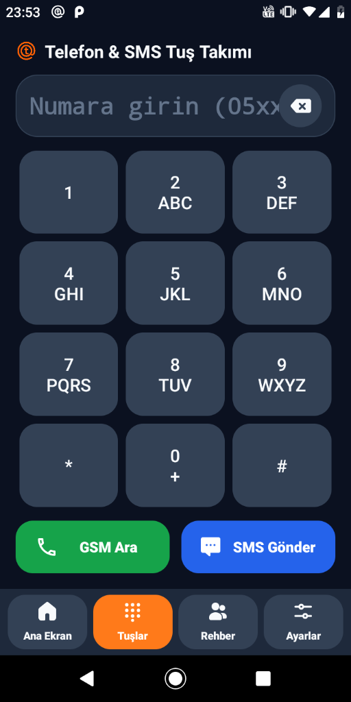

<div align="center">


# T-Switch
### T-Noktası GSM ↔ SIP Call Switcher

**Root'lu bir Android telefonu 7/24 çalışan dijital GSM ↔ SIP köprüsüne dönüştürün.**  
SIM kartınız yedek Android telefonda kalsın; tüm aramalarınızı ve SMS'lerinizi **iPhone (Linphone / Apple PushKit)** veya kendi SIP istemciniz üzerinden net, yankısız ve dijital sesle yönetin.


</div>

---

## Örnek Ekran Görüntüleri

<div align="center">
<table>
  <tr>
    <td align="center">
      <br/>
      <b>1. Ana Ekran &amp; Canlı Sistem Paneli</b><br/>
      <sub>Kayıt/TLS durumu, LTE &amp; Wi-Fi sinyali, PushKit özeti ve çağrı/SMS geçmişi</sub>
    </td>
    <td align="center">
      <br/>
      <b>2. Ayarlar &amp; Linphone PushKit</b><br/>
      <sub>Apple PushKit uyandırıcı, SIP hesap ayarları ve tek tık PushKit testi</sub>
    </td>
    <td align="center">
      <br/>
      <b>3. Telefon &amp; SMS Tuş Takımı</b><br/>
      <sub>Doğrudan GSM arama, hızlı SMS gönderimi ve alt gezinme çubuğu</sub>
    </td>
  </tr>
</table>
</div>

---

## T-Switch Nedir ve Ne İşe Yarar?

Yanınızda iki telefon taşımak istemiyorsanız, yedek hattınızı (veya yurt dışı / şirket / ikinci SIM kartınızı) evde ya da çantanızda duran **root'lu bir Android cihaza** takıp **T-Switch** ile ana telefonunuza bağlayabilirsiniz.

- **Gelen Aramalar:** Android'deki SIM karta bir arama geldiğinde T-Switch, iPhone'daki Linphone uygulamasını **Apple PushKit** ile ekran kilitli olsa bile anında uyandırır ve çaldırır. Aramayı açtığınızda ses iki yönlü olarak tamamen dijital şekilde aktarılır.
- **Giden Aramalar:** iPhone'daki sohbet ekranına `!ara 05xx...` veya `!ara Ahmet` yazmanız yeterlidir. Önce sizin telefonunuz çalar, açtığınızda Android cihaz karşı tarafı GSM hattından arar ve sesi birleştirir.
- **Çift Yönlü SMS:** Banka doğrulama kodları dahil gelen tüm SMS'ler anında Linphone'a düşer. `!sms Ahmet Yoldayım` yazarak SIM kartınızdan gerçek GSM SMS gönderebilirsiniz.
- **Sessiz ve Yankısız Dijital Ses:** Hoparlör ile mikrofon arasında ses çalma gibi ilkel yöntemler kullanmaz. Doğrudan işlemcinin ses yolundan (ALSA / `Incall_Music` / `VOICE_DOWNLINK`) dijital veri okur ve yazar; Android cihazın hoparlörü ve mikrofonu tamamen sessiz kalır.

---

## Sistem Nasıl Çalışır?

```text
                       ┌───────────────────────────────────────────┐
                       │         T-Switch (Root'lu Android)        │
  GSM Şebekesi         │                                           │        Bulut / Yerel Ağ
 ┌────────────┐  SIM   │  GsmCallService ──▶ CallOrchestrator      │  TLS   ┌──────────────────┐
 │  Arayan /  │◄──────►│        │                  │               │◄──────►│  SIP Sunucusu    │
 │  SMS Ağı   │  Modem │  VOICE_DOWNLINK     SipClient / RTP       │  5061  │  (Linphone vb.)  │
 └────────────┘        │  libalsaplay.so     PushWakeController    │  UDP   └────────┬─────────┘
                       │  (ALSA Incall_Music & CVP TX Mute)        │  5060           │ PushKit /
                       │        │                  │               │                 │ SIP / RTP
                       │  SmsReceiver/Outbox  LocalSendController  │        ┌────────▼─────────┐
                       └───────────────────────────────────────────┘        │  iPhone / SIP    │
                                                                            │  İstemcisi       │
                                                                            │  (Linphone vb.)  │
                                                                            └──────────────────┘
```

### Çalışma Modları

| Mod | Nasıl Bağlanır? | Ne Zaman Tercih Edilmeli? |
| --- | --- | --- |
| **Bulut Modu** *(Varsayılan)*<br>`CLOUD_ONLY_LINPHONE` | `sip.linphone.org:5061` (TLS) + Apple PushKit | İki cihaz farklı ağlardayken (evdeki Wi-Fi ↔ mobil veri) 7/24 kesintisiz kullanım için. |
| **Hibrit Yerel Mod**<br>`HYBRID_LOCAL_IP` | Hotspot / LAN sabit IP (`192.168.1.85:5060`, `tswitch.local`) + gerekirse PushKit | İki telefon aynı Wi-Fi veya hotspot üzerindeyken en düşük gecikme için. |
| **Özel SIP Sunucu Modu**<br>`CUSTOM_SIP_WITH_PUSH_WAKE` | Kendi Asterisk / FreePBX sunucunuz (UDP/TLS + isteğe bağlı SRTP) | Kendi VoIP santraliniz veya sesli asistan altyapınız varsa. |

---

## Hangi Cihazlarda Çalışır? Hangi Cihazlarda Çalışmaz?

T-Switch'in kalbi, GSM araması sırasında sesi **dijital olarak modemden okuyabilmek** ve **modeme geri enjekte edebilmektir**. Android'de bu özellik işlemciye (SoC) ve ses yongasına doğrudan bağlıdır.

### ✅ Hazır Profilli ve Desteklenen Cihazlar

Aşağıdaki cihazlar için `DeviceProfile.kt` içinde özel ses mikseri ve enjeksiyon profilleri hazırdır:

| Cihaz / Aile | İşlemci (SoC) | Durum | Ses Yolu Detayı |
| --- | --- | --- | --- |
| **General Mobile GM 8** *(Birincil Hedef)* | Qualcomm **MSM8937 / MSM8940 / MSM8953** (Snapdragon 430/435/625) | **Tam Optimize ✅** | Dahili `libalsaplay.so` + atomik `libtinyalsa.so` ile `/dev/snd/pcmC0D12p` (`Incall_Music`) enjeksiyonu ve CVP TX mikrofon susturma. |
| **Poco X3 / X3 NFC & Google Pixel 4a** | Qualcomm **SM6150 / SM7150** (Snapdragon 675/730G/732G) | **Destekleniyor ✅** | WCD9375 codec ve `Incall_Music` DSP yolu + `halCallActiveVsids` desteği. |
| **Samsung Galaxy S4 Mini** | Qualcomm **MSM8930** (WCD9304) | **Destekleniyor ✅** | `Incall_Music` ve dijital `VOICE_DOWNLINK` profili. |
| **Samsung Galaxy S10e** | Samsung **Exynos 9820** (`SM-G970`) | **Özel Profil ✅** | ABOX/Exynos ses mikseri profili. |

### 🟡 Çalışabilecek Diğer Cihazlar

- **Diğer Root'lu Qualcomm Snapdragon Android Telefonlar:** T-Switch, tanımadığı Qualcomm işlemcilerde otomatik olarak `Generic Qualcomm` profiline geçer ve `Incall_Music Audio Mixer MultiMedia1/2` yollarını dener.
- Özellikle **Snapdragon 4xx / 6xx / 7xx / 8xx** serisi, bootloader kilidi açılabilen ve Magisk ile root'lanabilen cihazların (Xiaomi, Redmi, Poco, eski Pixel, OnePlus, Motorola, GM vb.) çoğunda doğrudan çalışır ya da birkaç `tinymix` kontrol adı eklenerek kolayca uyarlanabilir.

### ❌ Çalışamayacak Cihazlar ve Basit Nedenleri

Aşağıdaki cihazlarda T-Switch **çalışmaz** veya ses **tek yönlü / sessiz** kalır:

1. **Root (Magisk) Olmayan Tüm Android Telefonlar**
   - *Neden?* Android, güvenlik gereği normal uygulamaların telefon görüşmesinin iç sesini dinlemesine (`CAPTURE_AUDIO_OUTPUT`) ve ses mikserine (`tinymix` / `/dev/snd/pcm*`) yazmasına kesinlikle izin vermez. Root olmadan dijital köprü kurulamaz.
2. **MediaTek (Helio / Dimensity), Huawei Kirin, Google Tensor ve Unisoc İşlemcili Cihazlar**
   - *Neden?* Bu işlemciler Qualcomm'un standart `Incall_Music` dijital ses enjeksiyon yolunu kullanmaz; kapalı ve üreticiye özel ses mimarilerine sahiptir. Karşı tarafa ses göndermeye çalışıldığında ses ya cihazın kendi hoparlöründen dışarı çıkar ya da karşıya hiç ulaşmaz.
3. **Çoğu Samsung Exynos Modeli** *(S10e Exynos 9820 hariç)*
   - *Neden?* Exynos modellerinde modem ses yolları (ABOX) modele göre büyük farklılık gösterir ve standart `Incall_Music` kontrolü bulunmaz; cihaz bazlı tersine mühendislik yapılmadan ses enjeksiyonu çalışmaz.
4. **Bootloader Kilidi Açılamayan Cihazlar** *(örn. güncel Huawei/Honor modelleri, operatör kilitli telefonlar)*
   - *Neden?* Bootloader açılmadan Magisk root ve ayrıcalıklı sistem uygulaması (`priv-app`) kurulamaz.
5. **VoLTE / IMS Sürücüsü Ses Yakalamayı Kilitleyen Bazı Stok ROM'lar**
   - *Neden?* Bazı üretici ROM'larında VoLTE açıkken modem `VOICE_DOWNLINK` kanalını sıfır (sessiz) verir. Bu durumda VoLTE kapatılarak (3G/2G) veya LineageOS gibi temiz bir AOSP ROM kurularak sorun çoğu zaman aşılabilir.
6. **iPhone / iOS Cihazlar (Köprü / Gateway Tarafı Olarak)**
   - *Neden?* iOS, GSM modem sesine veya ALSA katmanına erişime izin vermez. iPhone bu sistemde **köprü** değil, **alıcı (Linphone istemcisi)** olarak kullanılır.

> **Hızlı Uygunluk Kontrolü:** Elinizdeki yedek telefon **Qualcomm Snapdragon** işlemcili, **Android 8.0+**, **bootloader kilidi açılabilir** ve **Magisk root** kurulabilir bir cihazsa T-Switch için çok yüksek ihtimalle uygundur.

---

## T-Switch Terminal Komutları

Eşleştirdiğiniz SIP hesabından (ör. iPhone Linphone sohbet ekranından) aşağıdaki komutları mesaj olarak gönderebilirsiniz:

| Komut | Açıklama |
| --- | --- |
| `!ara <numara veya ad>` | Önce iPhone'u çaldırır; açtığınızda GSM hattından numarayı veya rehberdeki kişiyi arar. |
| `!sms <numara veya ad> <mesaj>` | Belirtilen numaraya veya rehberdeki kişiye GSM SMS gönderir. |
| `!geneldurum` / `!durum` | Batarya, sıcaklık, şebeke sinyali, IP, SIP ve PushKit özetini gönderir. |
| `!batarya` | Pil yüzdesi, şarj durumu, voltaj ve sıcaklık detayını gösterir. |
| `!ekran ac` / `!ekran kapat` | Android cihazın ekranını uzaktan açar veya kapatır. |
| `!kiosk ac` / `!kiosk kapat` | Kiosk / launcher ve güç tasarruf modunu yönetir. |
| `!internet` | Mobil veri / hotspot internet paylaşımını açıp kapatır. |
| `!gb` | Operatör kalan internet/paket sorgusu (SMS) tetikler. |
| `!snoop` | Aktif aramada Android cihaz hoparlöründen canlı dinlemeyi açar/kapatır. |
| `!push` / `!push test` | PushKit durumunu gösterir veya iPhone'a uyandırma testi gönderir. |
| `!yardim` | Tüm yerleşik ve özel komutların listesini döner. |
| `$ <komut>` | Yalnızca yetkili gönderen için root shell komutu çalıştırır. |

---

## Öne Çıkan Diğer Özellikler

- **7/24 Kiosk & Güç Yönetimi:** Ekranı kapalı tutar, gereksiz sistem paketlerini tek tuşla dondurabilir (`Debloat`), pil kritik eşiğin (varsayılan `%15`) altına indiğinde her `%1` düşüşte SMS hakkı harcamadan SIP uyarısı yollar.
- **Kesintisiz SMS Kuyruğu:** İnternet kopukken gelen GSM SMS'leri diskte saklanır (`SmsStore`); bağlantı geldiği anda sırayla iletilir.
- **Yerel Yedek Telefon (Fallback):** iPhone'a veya SIP istemcisine ulaşılamazsa gelen arama Android cihazın ekranında çalarak doğrudan cevaplanabilir; ayrıca uygulama içinde tuş takımı ve rehber sekmesi vardır.
- **Otomatik Açılış & İzin Koruma:** `BootReceiver` cihaz yeniden başladığında `RECORD_AUDIO` appops iznini root ile yeniler ve köprüyü otomatik başlatır.

---

## Derleme ve Kurulum

### 1. Gereksinimler
- **JDK 17** *(Android Gradle Plugin 8.2.2 için gereklidir; Java 8 ile derlenmez)*
- **Android SDK (API 34)** ve **Android NDK** (`alsaplay.c` native derlemesi için)
- Root'lu Android cihaz (**Magisk** önerilir)

### 2. Test ve APK Derleme (Windows PowerShell)

```powershell
# Gerekirse bu oturum için JDK 17 yolunu gösterin
$env:JAVA_HOME = "C:\Program Files\Android\Android Studio\jbr"
$env:PATH = "$env:JAVA_HOME\bin;$env:PATH"

# Birim testlerini çalıştırın
.\gradlew.bat testDebugUnitTest --no-daemon

# Debug APK derleyin
.\gradlew.bat assembleDebug --no-daemon
```

APK çıktısı `app/build/outputs/apk/debug/app-debug.apk` konumunda oluşur.

### 3. Cihaza Kurulum
- `CAPTURE_AUDIO_OUTPUT` ayrıcalıklı izni için `magisk/` klasöründeki Magisk modülü ile uygulamayı sistem (`priv-app`) olarak kurmanız önerilir.
- Kurulum sonrası T-Switch'i (`com.tnoktasi.tswitch`) **Varsayılan Telefon Uygulaması (Default Dialer)** olarak seçin ve Magisk'ten **root izni** verin.
- Güncellemelerde hızlı yükleme için:
  ```powershell
  adb install -r app\build\outputs\apk\debug\app-debug.apk
  ```

### 4. İlk Yapılandırma (5 Dakikada Hazır)

> **Gizlilik Notu:** Kaynak kodda herhangi bir kişisel SIP hesabı, şifre veya telefon numarası gömülü **değildir**. Tüm bilgiler yalnızca kendi cihazınızda saklanır.

1. Ücretsiz iki SIP hesabı oluşturun (ör. `sip.linphone.org` üzerinde bir **Gönderici / Gateway** hesabı, bir **Alıcı / iPhone** hesabı).
2. iPhone'da **Linphone** uygulamasını açıp **Alıcı** hesabınızla giriş yapın ve Push bildirimlerinin açık olduğundan emin olun.
3. Android'de **T-Switch → Ayarlar → Linphone Hibrit PushKit** bölümüne gidin:
   - **Linphone SIP Domain:** `sip.linphone.org`
   - **Gateway Gönderici Hesabı (Pusher):** kendi gönderici kullanıcı adınız
   - **Gönderici SIP Şifresi:** gönderici hesabınızın şifresi
   - **iPhone Alıcı Hesabı (Receiver):** iPhone'daki alıcı kullanıcı adınız
4. **Push Kaydet** butonuna basın.
5. **PushKit Test** ile iPhone'un ekranı kilitliyken bile çaldığını doğrulayın — sistem kullanıma hazır!

---

## Sık Sorulan Sorular & Hızlı Sorun Giderme

- **Gradle derlerken `compatible with Java 8 ... compatible with Java 11` hatası alıyorum:**  
  Terminalinizde Java 8 seçilidir. `$env:JAVA_HOME` değişkenini JDK 17'ye (veya Android Studio'nun `jbr` klasörüne) yönlendirip tekrar deneyin.
- **Gelen aramada karşı tarafın sesini duyuyorum ama benim sesim gitmiyor:**  
  Cihazın root erişimini, Magisk `priv-app` kurulumunu ve `DeviceProfile` eşleşmesini (`Ayarlar → Loglar` ekranından) kontrol edin. GM 8 (`msm8937`) dışındaki bir Qualcomm cihazda `tinymix` yolları farklı olabilir.
- **iPhone ekranı kapalıyken çağrı düşmüyor:**  
  iPhone Linphone ayarlarında Push bildirimlerinin açık olduğunu ve T-Switch'te **PushKit Test** butonunun `180 Ringing` döndürdüğünü doğrulayın.

---

## Güvenlik ve Gizlilik

- **Yetkili Gönderen Kontrolü (`CommandAuthorization`):** Bulut üzerinden gelen `!ara`, `!sms`, terminal ve `$ <komut>` istekleri yalnızca tanımladığınız eşleşmiş **Alıcı** hesabından ve izin verilen SIP alan adından gelirse işlenir; diğer tüm gönderenler `403 Forbidden` ile reddedilir.
- **Şifreli Sinyalleşme:** Bulut modunda SIP trafiği TLS (`5061`) üzerinden taşınır; Özel SIP Sunucu modunda TLS + SDES SRTP (RFC 3711) desteklenir.

---

## Proje Yapısı

```text
T-Switch/
├── app/
│   └── src/
│       ├── main/
│       │   ├── cpp/alsaplay.c                  # Root ALSA PCM uplink enjeksiyonu (libalsaplay.so)
│       │   ├── java/com/tnoktasi/tswitch/
│       │   │   ├── MainActivity.kt             # Ana panel, ayarlar, tuş takımı, rehber, yerel arama UI
│       │   │   ├── DeviceProfile.kt            # Cihaz & SoC bazlı ALSA/tinymix ses profilleri
│       │   │   ├── audio/                      # AlsaPcmPlayback, G711, G722, RtpSession
│       │   │   ├── bridge/                     # CallOrchestrator (çağrı yaşam döngüsü)
│       │   │   ├── gsm/                        # GsmCallService, GsmCallManager
│       │   │   ├── localsend/                  # PushWakeController, LocalSendController, CommandAuthorization,
│       │   │   │                               # KioskController, HotspotHelper, LocalIpPinController, mDNS
│       │   │   ├── service/                    # GatewayService, BootReceiver, RoutingPolicy
│       │   │   ├── sip/                        # SipClient, TlsSipTransport, SipAuth, SipBuilder
│       │   │   └── sms/                        # SmsReceiver, SmsSender, SmsStore, SmsOutbox
│       │   └── res/                            # Arayüz yerleşimleri, ikonlar ve renk temaları
│       └── test/                               # JVM birim testleri
├── docs/images/                                # README örnek ekran görselleri
├── magisk/                                     # Ayrıcalıklı izinler (priv-app) ve boot desteği
└── README.md
```

---

## Lisans

**T-Switch (T-Noktası GSM ↔ SIP Call Switcher)**, General Mobile GM 8 (`msm8937`) root ALSA ses enjeksiyonu, Apple PushKit hibrit bulut/yerel yönlendirme, Kiosk otomasyonu ve uzaktan komut terminali ile geliştirilmiş açık kaynaklı bir GSM ↔ SIP köprüsüdür.

Lisans detayları için [LICENSE](LICENSE) dosyasına göz atabilirsiniz.
