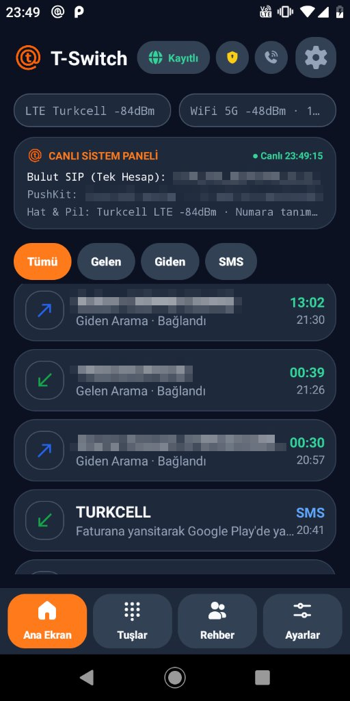
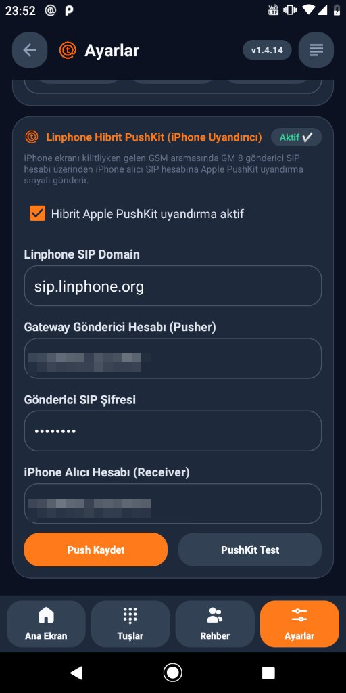

<div align="center">


# T-Switch
### T-Noktası GSM ↔ SIP Call Switcher

**🇬🇧 English** · [🇹🇷 Türkçe](README.tr.md)

**Turn a rooted Android phone into a 24/7 digital GSM ↔ SIP bridge.**  
Keep your SIM card in a spare Android device and handle all your cellular calls and SMS directly from your **iPhone (Linphone / Apple PushKit)** or any SIP client — with clean, echo-free, end-to-end digital audio.


</div>

---

## Screenshots

<div align="center">
<table>
  <tr>
    <td align="center">
      <br/>
      <b>1. Home &amp; Live Dashboard</b><br/>
      <sub>Registration/TLS badges, LTE &amp; Wi-Fi signal, PushKit summary, and call/SMS history</sub>
    </td>
    <td align="center">
      <br/>
      <b>2. Settings &amp; Linphone PushKit</b><br/>
      <sub>Apple PushKit wake-up config, SIP credentials, and one-tap PushKit test</sub>
    </td>
    <td align="center">
      <br/>
      <b>3. Local Dialer &amp; Quick SMS</b><br/>
      <sub>Direct GSM calling, quick SMS composer, and bottom navigation</sub>
    </td>
  </tr>
</table>
</div>

---

## What is T-Switch?

If you don't want to carry two phones, you can leave your secondary SIM (personal, travel, work, or roaming SIM) inside a **rooted Android phone** at home or in your bag and bridge it to your main phone with **T-Switch**.

- **Incoming Calls (Even with Locked Screen):** When a GSM call arrives, T-Switch wakes your iPhone's Linphone app instantly via **Apple PushKit (SIP TLS 5061)**. Once you answer, audio is bridged digitally in both directions.
- **Outgoing Calls (`!ara`):** Send `!ara +1555...` or `!ara John` from your Linphone chat. T-Switch rings your iPhone first; as soon as you pick up, it dials the destination over GSM and bridges the call.
- **Two-Way SMS:** Incoming GSM SMS messages (including bank 2FA codes) are forwarded to Linphone immediately. Reply or send new SMS messages over your SIM card with `!sms John On my way`.
- **Silent, Echo-Free Digital Audio:** No speaker-to-microphone acoustic coupling. T-Switch reads and injects audio directly through the modem's digital paths (`VOICE_DOWNLINK` & ALSA `Incall_Music`), keeping the Android phone's physical speaker and microphone completely silent.

---

## Architecture

```text
                       ┌───────────────────────────────────────────┐
                       │          T-Switch (Rooted Android)        │
  Cellular Network     │                                           │       Cloud / Local Network
 ┌────────────┐  SIM   │  GsmCallService ──▶ CallOrchestrator      │  TLS   ┌──────────────────┐
 │  Caller /  │◄──────►│        │                  │               │◄──────►│    SIP Server    │
 │  SMSC      │  Modem │  VOICE_DOWNLINK     SipClient / RTP       │  5061  │  (Linphone etc.) │
 └────────────┘        │  libalsaplay.so     PushWakeController    │  UDP   └────────┬─────────┘
                       │  (ALSA Incall_Music & CVP TX Mute)        │  5060           │ PushKit /
                       │        │                  │               │                 │ SIP / RTP
                       │  SmsReceiver/Outbox  LocalSendController  │        ┌────────▼─────────┐
                       └───────────────────────────────────────────┘        │  iPhone / SIP    │
                                                                            │  Client          │
                                                                            │  (Linphone etc.) │
                                                                            └──────────────────┘
```

### Operating Modes

| Mode | Connection | Best For |
| --- | --- | --- |
| **Cloud Mode** *(Default)*<br>`CLOUD_ONLY_LINPHONE` | `sip.linphone.org:5061` (TLS) + Apple PushKit | 24/7 use across different networks (home Wi-Fi ↔ cellular data). |
| **Hybrid Local Mode**<br>`HYBRID_LOCAL_IP` | Fixed LAN/Hotspot IP (`192.168.1.85:5060`, `tswitch.local` mDNS) + PushKit wake | Lowest latency when both phones share the same Wi-Fi or hotspot. |
| **Custom SIP Server Mode**<br>`CUSTOM_SIP_WITH_PUSH_WAKE` | Your own Asterisk / FreePBX server (UDP/TLS + optional SDES SRTP) | Self-hosted PBX or voice-agent integrations. |

---

## Device Compatibility — What Works & What Doesn't

T-Switch relies on **reading cellular downlink audio digitally** and **injecting SIP audio directly into the modem uplink**. On Android, this depends heavily on the SoC (chipset) and audio HAL.

### ✅ Built-in Tested Profiles

Dedicated ALSA/mixer profiles are included in `DeviceProfile.kt`:

| Device / Family | SoC | Status | Audio Path Details |
| --- | --- | --- | --- |
| **General Mobile GM 8** *(Primary Target)* | Qualcomm **MSM8937 / MSM8940 / MSM8953** (Snapdragon 430/435/625) | **Fully Optimized ✅** | Bundled `libalsaplay.so` + atomic `libtinyalsa.so` direct PCM injection to `/dev/snd/pcmC0D12p` (`Incall_Music`) with CVP TX mic mute. |
| **Poco X3 / X3 NFC & Google Pixel 4a** | Qualcomm **SM6150 / SM7150** (Snapdragon 675/730G/732G) | **Supported ✅** | WCD9375 codec, `Incall_Music` DSP path, and `halCallActiveVsids` activation. |
| **Samsung Galaxy S4 Mini** | Qualcomm **MSM8930** (WCD9304) | **Supported ✅** | `Incall_Music` + digital `VOICE_DOWNLINK` profile. |
| **Samsung Galaxy S10e** | Samsung **Exynos 9820** (`SM-G970`) | **Custom Profile ✅** | ABOX/Exynos mixer profile. |

### 🟡 Other Compatible Devices

- **Other Rooted Qualcomm Snapdragon Android Phones:** Unknown Qualcomm devices automatically fall back to the `Generic Qualcomm` profile (`Incall_Music Audio Mixer MultiMedia1/2`).
- Most **Snapdragon 4xx / 6xx / 7xx / 8xx** phones with an unlockable bootloader and Magisk root (Xiaomi, Redmi, Poco, older Pixels, OnePlus, Motorola, GM, etc.) either work out of the box or only need a few `tinymix` control names added to `DeviceProfile.kt`.

### ❌ Unsupported Devices & Why They Don't Work

T-Switch will **not work** (or will produce one-way / silent audio) on:

1. **Any Non-Rooted Android Phone**
   - *Why?* Android blocks regular apps from reading in-call audio (`CAPTURE_AUDIO_OUTPUT`) and touching kernel ALSA mixers (`/dev/snd/pcm*`, `tinymix`). Without Magisk root, a digital audio bridge is impossible.
2. **MediaTek (Helio / Dimensity), Huawei Kirin, Google Tensor & Unisoc Devices**
   - *Why?* These chipsets do not expose Qualcomm's standard `Incall_Music` DSP uplink mixer. They use proprietary audio architectures where injected audio either plays out of the phone's loudspeaker or never reaches the remote caller.
3. **Most Samsung Exynos Models** *(except S10e Exynos 9820)*
   - *Why?* Exynos ABOX audio routing differs drastically per model and lacks a standard `Incall_Music` path, requiring per-device reverse engineering.
4. **Phones with Permanently Locked Bootloaders** *(e.g., modern Huawei/Honor or carrier-locked models)*
   - *Why?* Magisk root and `priv-app` privileged permissions cannot be installed.
5. **Stock ROMs Where VoLTE / IMS Blocks Downlink Capture**
   - *Why?* Some vendor ROMs output digital silence on `VOICE_DOWNLINK` during VoLTE calls. Disabling VoLTE (falling back to 3G/2G) or flashing a clean AOSP ROM (such as LineageOS) often resolves this.
6. **iPhone / iOS as the Gateway Device**
   - *Why?* iOS provides no access to modem audio or ALSA mixers. In T-Switch, the iPhone is the **client/receiver** (Linphone), not the GSM gateway.

> **Quick Check:** If your spare phone has a **Qualcomm Snapdragon** chipset, runs **Android 8.0+**, has an **unlockable bootloader**, and supports **Magisk root**, it is a strong candidate for T-Switch.

---

## Remote Terminal Commands (SIP MESSAGE)

Send any of these commands directly from your paired SIP client (e.g., iPhone Linphone chat):

| Command | Action |
| --- | --- |
| `!ara <number or contact>` | Initiates an iPhone-first callback and dials the number or matched contact over GSM. |
| `!sms <number or contact> <text>` | Sends an outbound GSM SMS to the number or matched contact. |
| `!geneldurum` / `!durum` | Returns battery, temperature, cellular signal, IP, SIP, and PushKit status. |
| `!batarya` | Detailed battery percentage, charging state, voltage, and temperature. |
| `!ekran ac` / `!ekran kapat` | Remotely turns the Android screen on or off. |
| `!kiosk ac` / `!kiosk kapat` | Toggles Kiosk / launcher power-saving mode. |
| `!internet` | Toggles mobile data / hotspot sharing. |
| `!gb` | Triggers carrier remaining-data SMS query. |
| `!snoop` | Toggles live speaker monitoring on the gateway during a call (mic stays muted). |
| `!push` / `!push test` | Shows PushKit status or sends a test wake signal to your iPhone. |
| `!yardim` | Lists all built-in and user-defined custom commands. |
| `$ <shell command>` | Runs a root shell command (strictly restricted to the authorized paired sender). |

---

## Additional Features

- **24/7 Kiosk & Battery Protection:** Keeps the display off, supports one-tap `Debloat`, and sends free SIP low-battery alerts for every 1% drop below your configured threshold (default `15%`) when unplugged.
- **Reliable SMS Queue:** Incoming GSM SMS messages are persisted to disk (`SmsStore`) while offline and automatically flushed once SIP re-registers.
- **Local Fallback Phone UI:** If the SIP client is unreachable, incoming GSM calls ring directly on the Android screen so you can answer locally; includes a built-in dialer and contacts tab.
- **Cold-Boot Self-Healing:** `BootReceiver` automatically restores `RECORD_AUDIO` appops via root on boot and brings the gateway online unattended.

---

## Build & Installation

### 1. Prerequisites
- **JDK 17** *(required by Android Gradle Plugin 8.2.2; Java 8 will fail)*
- **Android SDK (API 34)** & **Android NDK** (for compiling `alsaplay.c`)
- Rooted Android device (**Magisk** recommended)

### 2. Run Tests & Build APK (Windows PowerShell)

```powershell
# Point this shell session to JDK 17 (e.g., Android Studio's bundled JBR)
$env:JAVA_HOME = "C:\Program Files\Android\Android Studio\jbr"
$env:PATH = "$env:JAVA_HOME\bin;$env:PATH"

# Run unit tests
.\gradlew.bat testDebugUnitTest --no-daemon

# Build Debug APK
.\gradlew.bat assembleDebug --no-daemon
```

The APK is generated at `app/build/outputs/apk/debug/app-debug.apk`.

### 3. Install on Device
- Flash the Magisk module in `magisk/` so `com.tnoktasi.tswitch` is installed as a privileged system app (`priv-app`) with `CAPTURE_AUDIO_OUTPUT`.
- Set **T-Switch** (`com.tnoktasi.tswitch`) as the **Default Phone App (Dialer)** and grant **Magisk superuser** permission.
- For quick subsequent updates:
  ```powershell
  adb install -r app\build\outputs\apk\debug\app-debug.apk
  ```

### 4. First-Time Setup (5 Minutes)

> **Privacy Note:** Zero personal SIP accounts, passwords, or phone numbers are hardcoded in the repository. All credentials are stored locally in `SharedPreferences` on your device.

1. Create two free SIP accounts (e.g., on `sip.linphone.org`: one **Gateway / Pusher** account and one **iPhone / Receiver** account).
2. Sign in to **Linphone** on your iPhone with the **Receiver** account and ensure Push notifications are enabled.
3. On Android, open **T-Switch → Settings → Linphone Hybrid PushKit** and enter:
   - **Linphone SIP Domain:** `sip.linphone.org`
   - **Gateway Pusher Account:** your gateway SIP username
   - **Pusher SIP Password:** your gateway SIP password
   - **iPhone Receiver Account:** your iPhone SIP username
4. Tap **Push Kaydet** (Save).
5. Tap **PushKit Test** and confirm your iPhone rings even with the screen locked — you're live!

---

## Troubleshooting & FAQ

- **Gradle fails with `compatible with Java 8 ... compatible with Java 11`:**  
  Your terminal is using Java 8. Set `JAVA_HOME` to JDK 17 (or Android Studio's `jbr`) and re-run.
- **I can hear the caller, but they cannot hear my voice:**  
  Verify Magisk root access, `priv-app` installation, and check `Settings → Logs` to confirm your `DeviceProfile` matched properly. Non-GM 8 Qualcomm devices may require custom `tinymix` control names.
- **iPhone doesn't ring when the screen is locked:**  
  Confirm Push notifications are enabled in iPhone Linphone settings and that **PushKit Test** receives `180 Ringing`.

---

## Security & Privacy

- **Strict Sender Authorization (`CommandAuthorization`):** Cloud `!ara`, `!sms`, terminal, and `$ <cmd>` requests are only accepted if BOTH the SIP username and SIP domain match your configured **Receiver** account; all other senders receive `403 Forbidden`.
- **Encrypted Signalling & Media:** Cloud mode runs SIP over **TLS (5061)**; Custom SIP Server mode supports **TLS + SDES SRTP (RFC 3711)**.

---

## Project Structure

```text
T-Switch/
├── app/
│   └── src/
│       ├── main/
│       │   ├── cpp/alsaplay.c                  # Root ALSA PCM uplink injector (libalsaplay.so)
│       │   ├── java/com/tnoktasi/tswitch/
│       │   │   ├── MainActivity.kt             # Dashboard, settings, dialer, contacts, local fallback UI
│       │   │   ├── DeviceProfile.kt            # Per-SoC ALSA / tinymix audio routing profiles
│       │   │   ├── bridge/                     # CallOrchestrator (GSM ↔ SIP call state machine)
│       │   │   ├── gsm/                        # GsmCallService, GsmCallManager
│       │   │   ├── localsend/                  # PushWakeController, LocalSendController, CommandAuthorization,
│       │   │   │                               # KioskController, HotspotHelper, LocalIpPinController, mDNS
│       │   │   ├── rtp/                        # AlsaPcmPlayback, G722Codec, PcmuCodec, RtpSession, Srtp
│       │   │   ├── service/                    # GatewayService, BootReceiver, CallLogStore
│       │   │   ├── sip/                        # SipClient, SipAuth, SipBuilder, SipMessage, SipTransport
│       │   │   └── sms/                        # SmsReceiver, SmsSender, SmsStore, SmsOutbox
│       │   └── res/                            # Layouts, icons, dark/light themes
│       └── test/                               # JVM unit tests
├── docs/images/                                # README screenshots
├── magisk/                                     # Magisk module for priv-app permissions & boot hooks
├── README.md                                   # English documentation (default)
└── README.tr.md                                # Turkish documentation
```

---

## License

Released under the **MIT License** — see [LICENSE](LICENSE) for details.
